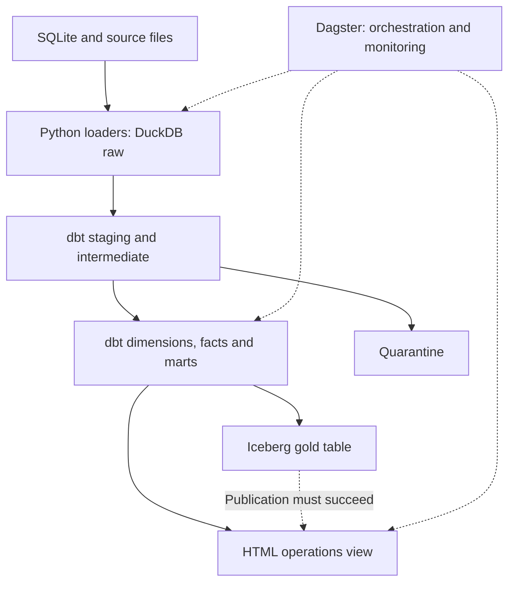

# Qafila Lakehouse

**Option 1 — SDAIA Academy Data Engineering Capstone**

Submitted by: Mashael Alotaibi — academy: @SDAIAAcademy

Built from the [SDAIA Academy starter repository](https://github.com/SDAIAAcademy/data-engineering/tree/main/labs/capstone).

## Problem

Qafila operations needs daily orders, sales and delivery-SLA indicators
for Riyadh, Jeddah and Dammam. This platform turns application data
and source files into tested analytical tables and a local operations view.

## Sources

| Source | Type | Volume | Load strategy | Known issues |
|---|---|---|---|---|
| Qafila application | SQLite database | 45,766 orders; 172,545 order lines | Full refresh | Invalid quantities, duplicate accounts and orphan orders |
| Payments extract | JSONL file | 41,785 payments | Incremental merge | 16 non-positive amounts |
| Delivery events | JSONL events file | 22,518 source rows; 22,206 unique events | Incremental insert | Duplicate and late events; mixed timestamp formats |
| Supplier prices | CSV files | 640 rows | Full refresh | Column changes, number formats and 4 invalid costs |
| Reviews | CSV file | 3,000 rows | Full refresh | Potentially identifying free text |

Data is synthetic and generated by `labs/prepare_data.py`.

Payments are read from an API extract file; this project does not
make live API requests.

## Architecture



The operations view reads the daily city mart in DuckDB after successful
Iceberg publication. It does not read the Iceberg table directly.

| Stage | Implementation |
|---|---|
| Sources | SQLite database, JSONL extracts and CSV files |
| Ingest | Python and DuckDB loaders |
| Store | DuckDB raw tables and an Iceberg gold table |
| Transform | dbt staging, intermediate models, dimensions and facts |
| Test | dbt tests, payments contract and incremental-loader checks |
| Serve | Local HTML operations view |
| Orchestrate | Dagster assets, job and schedule definition |
| Observe | Run logs, asset metadata, quality checks and volume monitor |
| Govern | Customer identifier protection, classification and local access controls |

Tool choices:

- **DuckDB:** local storage and analytical SQL.
- **dbt:** SQL transformations, dependencies and data tests.
- **Dagster:** orchestration, lineage, logs and asset checks.
- **Iceberg:** publication in an open table format.
- **Python and HTML:** a local operations view without extra UI dependencies.

See [platform coverage and decisions](labs/docs/architecture.md).

## Data model

| Table | Layer | Grain | Key | Materialization |
|---|---|---|---|---|
| `fct_orders` | Marts | One row per order | `order_id` | Table |
| `fct_order_items` | Marts | One positive-quantity order line | `order_line_id` | Incremental |
| `mart_daily_city_sales` | Marts | One Riyadh calendar day and city | `order_date`, `city` | Table |
| `gold.daily_city_sales` | Iceberg | One Riyadh calendar day and city | `order_date`, `city` | Overwrite |

Sales include delivered-order item amounts and exclude delivery fees.
SLA rates exclude orders whose delivery timing is unknown.

See [data model](labs/docs/data_model.md).

## Quality and observability

The latest verified build ran 47 dbt data tests and 3 unit tests.
Dagster also runs the payments contract and order-volume monitor.

A successful pipeline run does not mean every quality check passed:
documented warning-level failures remain visible.

| Check | Policy | Verified result |
|---|---|---|
| Invalid raw payment amounts | Warn and quarantine | 16 isolated |
| Invalid payment amounts in staging | Error | Passed |
| Payment routing completeness | Error | Passed |
| Quarantined order lines appearing in the fact | Error | Passed; 142 lines quarantined |
| Invalid supplier costs | Warn and quarantine | 4 isolated; 636 valid prices |
| Invalid costs in the valid-price model | Error | Passed |
| Order-total/payment reconciliation | Warn and investigate | 244 mismatches remain |
| Keys, relationships and accepted values | dbt tests | Results available when the build runs |

**Project quality-review owner:** Mashael Alotaibi.

Corrections come from the source; financial amounts are not guessed
or changed to force a test to pass.

The 244 reconciliation mismatches remain unresolved. The operations
view is not a financially reconciled statement.

See [quality policy](labs/docs/data_quality.md).

## Incremental loads and reruns

### Payments

- **Key:** `payment_id`.
- **Watermark:** latest successfully stored `updated_at`.
- **Review window:** three days before that watermark.
- On the first load, all source records are eligible.
- On later loads, eligible new keys are inserted and eligible changed
  records are merged without overwriting a newer stored version.
- Tests verify insertion, update, preservation and identical replay.

The three-day window is an initial project choice, not a measured
guarantee that all late changes will arrive within it. Payment records
outside the window, including unseen older records, require a backfill.

### Delivery events

- **Key:** `event_id`; events are treated as immutable.
- **Watermark:** latest stored `ingest_time`.
- **Review window:** three days, plus every unseen event ID.
- Previously unseen events are inserted, including events outside
  the review window.
- Existing event IDs are not updated.
- Tests verify duplicates, late events, unseen older arrivals,
  preservation and identical replay.

Both loaders still scan the complete source file. The review window
limits records considered for loading; it does not avoid reading
the complete file.

Other source loaders remain full refresh.

## Governance

Customer names are redacted; email, mobile and IBAN are set to null
in the analytical raw copy. National IDs are replaced with person tokens
that preserve duplicate-account grouping.

Customer and transaction keys remain linkable personal information.
Pseudonymization does not make these records anonymous.

Only daily city aggregates appear in the operations view.

Source and artifact folders use local Windows filesystem permissions.
DuckDB schemas do not provide separate user-access enforcement.

Source data and generated warehouse/lakehouse files are excluded
from Git through ignore rules. The documented checks found no tracked
files in those generated-data folders; repository history was not audited.

The governance note includes proposed NDMO classification levels,
column handling, access restrictions and retention.

See [column classification, protection and retention](labs/docs/governance.md).

For an erasure request, identify the affected account/person records,
review source and derived copies, rebuild affected models and aggregates,
and address backups and Iceberg snapshots under the retention procedure.

An automated end-to-end erasure workflow is not implemented.

## Reproduce

Prerequisite: `uv` and a compatible Python environment.

Dependency versions are pinned in `labs/uv.lock`.

From the repository root:

```bash
cd labs
uv sync --frozen
uv run python prepare_data.py
```

Run the entire platform with one command:

```bash
uv run python capstone/pipeline.py
```

### Open the operations view

Run the following command for your operating system from `labs`.

Windows (PowerShell):

```powershell
Start-Process artifacts/capstone/operations.html
```

macOS:

```bash
open artifacts/capstone/operations.html
```

Linux with a desktop environment:

```bash
xdg-open artifacts/capstone/operations.html
```

These are operating-system-specific commands for opening the generated
HTML file. Full pipeline reproduction has been verified on Windows only.

### Run the incremental checks

```bash
uv run python capstone/check_payments_incremental.py
uv run python capstone/check_events_incremental.py
```

These checks use temporary test databases and verify loader behavior
without modifying the project warehouse.

### Optional Dagster UI

```bash
uv run dagster dev -f capstone/pipeline.py
```

Do not run concurrent writers against the same DuckDB file.

### Reproduction evidence

A separate local Windows clone completed dependency installation,
data preparation, the full pipeline and both incremental checks.

The documented result was 34 assets materialized and 47 asset-check
evaluations, with known quality warnings remaining.

See [reproduction verification](labs/docs/reproduction.md).

## Schedule and limitations

- A nightly 01:30 Asia/Riyadh schedule is defined. Automatic execution
  requires running Dagster services and an enabled schedule.
- Scheduled execution has not been demonstrated.
- Payment records outside the three-day review window need a backfill.
- Both incremental loaders still scan complete source files.
- Other source loaders remain full refresh.
- Gold publication overwrites the Iceberg table.
- Quarantine tables represent current rejected data, not review history.
- The 244 reconciliation mismatches remain visible warnings.
- Full pipeline reproduction on macOS and Linux has not been verified.