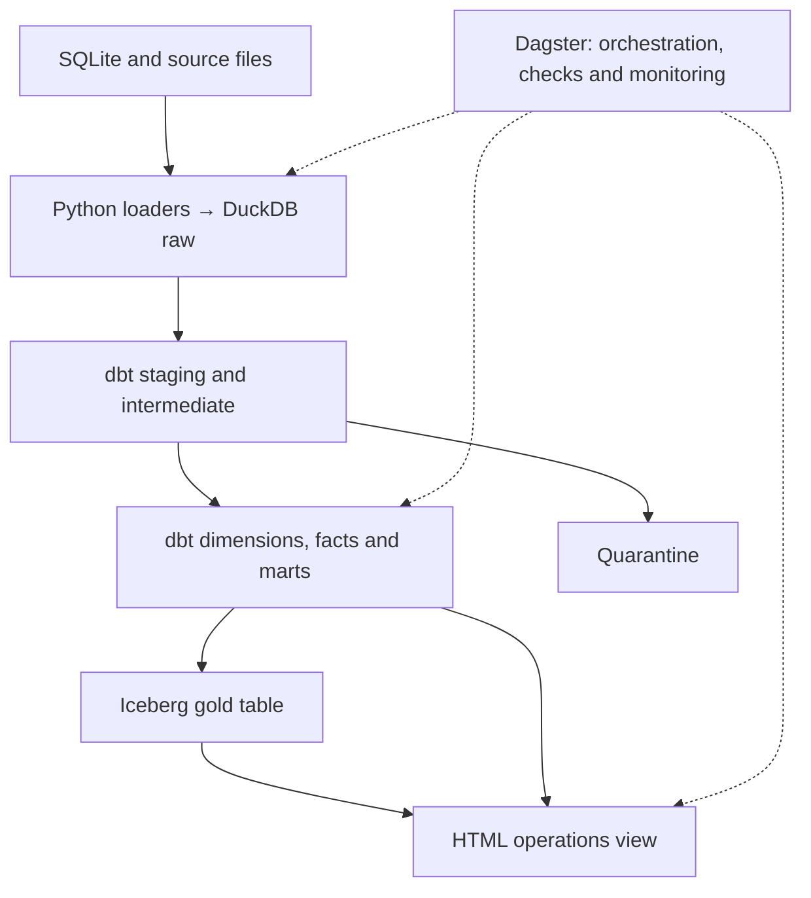

# Qafila Lakehouse

**Option 1 — SDAIA Academy Data Engineering Capstone**

Submitted by:Mashael Alotaibi — academy: @SDAIAAcademy


Built from the [SDAIA Academy starter repository](https://github.com/SDAIAAcademy/data-engineering/tree/main/labs/capstone).

## Problem

Qafila operations needs daily orders, sales and delivery-SLA indicators
for Riyadh, Jeddah and Dammam. This platform turns application data
and source files into tested analytical tables and a local operations view.

## Sources

| Source | Type | Volume | Load strategy | Known issues |
|---|---|---|---|---|
| Qafila application | SQLite database | 45,766 orders; 172,545 order lines | Full refresh | Invalid quantities, duplicate accounts and orphan orders |
| Payments extract | JSONL file | 41,785 payments | Incremental merge | 16 non-positive amounts |
| Delivery events | JSONL events file | 22,518 source rows; 22,206 unique events | Incremental insert | Duplicate and late events; mixed timestamp formats |
| Supplier prices | CSV files | 640 rows | Full refresh | Column changes, number formats and 4 invalid costs |
| Reviews | CSV file | 3,000 rows | Full refresh | Potentially identifying free text |

Data is synthetic and generated by labs/prepare_data.py.
Payments are read from an API extract file; this project does not
make live API requests.

## Architecture



The operations view reads the daily city mart after successful
Iceberg publication.

- DuckDB: local storage and analytical SQL.
- dbt: transformations, dependencies and data tests.
- Dagster: orchestration, lineage, logs and asset checks.
- Iceberg: publication in an open table format.
- Python and HTML: a local operations view without extra UI dependencies.

See [platform coverage and decisions](labs/docs/architecture.md).

## Data model

| Table | Layer | Grain | Key | Materialization |
|---|---|---|---|---|
| fct_orders | Marts | One row per order | order_id | Table |
| fct_order_items | Marts | One positive-quantity order line | order_line_id | Incremental |
| mart_daily_city_sales | Marts | One Riyadh calendar day and city | order_date, city | Table |
| gold.daily_city_sales | Iceberg | One Riyadh calendar day and city | order_date, city | Overwrite |

Sales include delivered-order item amounts and exclude delivery fees.
SLA rates exclude orders whose delivery timing is unknown.

See [data model](labs/docs/data_model.md).

## Quality and observability

The latest verified build ran 47 dbt data tests and 3 unit tests.
Dagster also runs the payments contract and order-volume monitor.

| Check | Policy | Verified result |
|---|---|---|
| Invalid raw payment amounts | Warn and quarantine | 16 isolated |
| Invalid payment amounts in staging | Error | Passed |
| Payment routing completeness | Error | Passed |
| Quarantined order lines appearing in the fact | Error | Passed; 142 lines quarantined |
| Invalid supplier costs | Warn and quarantine | 4 isolated; 636 valid prices |
| Invalid costs in the valid-price model | Error | Passed |
| Order-total/payment reconciliation | Warn and investigate | 244 mismatches remain |
| Keys, relationships and accepted values | dbt tests | See run results |

Project quality-review owner: Mashael Alotaibi.
Corrections come from the source; financial amounts are not guessed.

See [quality policy](labs/docs/data_quality.md).

## Incremental loads and reruns

### Payments
- Key: payment_id.
- Watermark: latest stored updated_at.
- Review window: three days.
- New keys are inserted; eligible newer or changed versions are merged.
- Tests verify insertion, update, preservation and identical replay.

### Delivery events
- Key: event_id; events are treated as immutable.
- Watermark: latest stored ingest_time.
- Review window: three days, plus every unseen event ID.
- Tests verify duplicates, late events, unseen older arrivals,
  preservation and identical replay.

Both loaders still scan the complete source file.
Other source loaders remain full refresh.

## Governance

Customer names are redacted; email, mobile and IBAN are removed
from the analytical raw copy. National IDs are replaced with person tokens
that preserve duplicate-account grouping.

Customer and transaction keys remain linkable personal information.
Only daily city aggregates appear in the operations view.

Source and artifact folders use local Windows permissions.
Source data and generated warehouse/lakehouse files are not committed.

See [column classification, protection and retention](labs/docs/governance.md).

For an erasure request, identify the affected account/person records,
review source and derived copies, rebuild affected models and aggregates,
and address backups and Iceberg snapshots under the retention procedure.
An automated end-to-end erasure workflow is not implemented.

## Reproduce

Prerequisite: uv and a compatible Python environment.
Dependency versions are pinned in labs/uv.lock.

From the repository root:

```powershell
cd labs
uv sync
uv run python prepare_data.py
```

Run the entire platform with one command:

```powershell
uv run python capstone/pipeline.py
```

Open the generated operations view on Windows:

```powershell
Start-Process artifacts/capstone/operations.html
```

Run the incremental demonstrations:

```powershell
uv run python capstone/check_payments_incremental.py
uv run python capstone/check_events_incremental.py
```

Optional Dagster UI:

```powershell
uv run dagster dev -f capstone/pipeline.py
```

Do not run concurrent writers against the same DuckDB file.

## Schedule and limitations

- A nightly 01:30 Asia/Riyadh schedule is defined; automatic execution
  requires the Dagster services and enabled schedule.
- Scheduled execution has not been demonstrated.
- Late payment updates outside the three-day window need a backfill.
- File scanning and full-refresh sources would become bottlenecks
  as volume grows; measure them before choosing a larger execution engine.
- Quarantine tables represent current rejected data, not review history.
- Reconciliation mismatches remain visible warnings.
- Fresh-environment reproduction still needs final verification.
